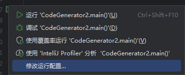
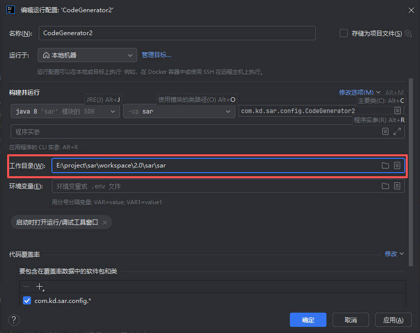
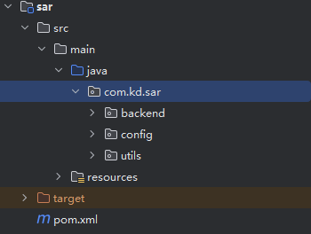
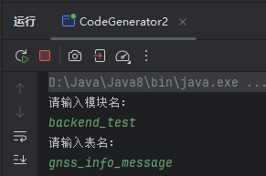
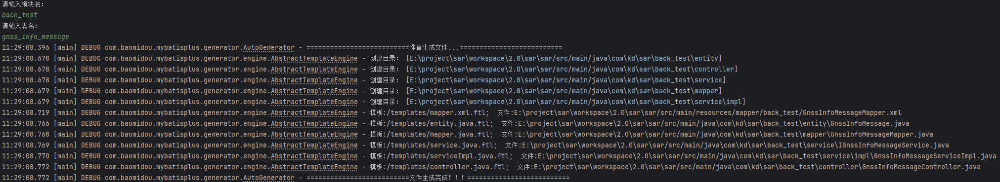
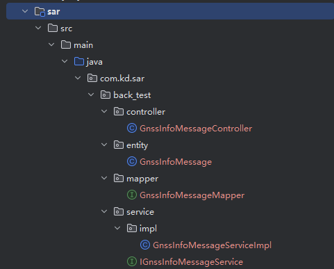

生成器目录：`sar[ruoyi]\sar\src\main\java\com\kd\sar\config\CodeGenerator`

	这是一个可运行的java程序，点击类名左侧的启动键启动程序。


# ***使用说明：***
## 1. 路径配置

程序第44行为文件生成目录：

```
String projectPath = System.getProperty("user.dir");
gc.setOutputDir(projectPath + "/src/main/java");
```

其中`System.getProperty("user.dir")`指的是当前程序的运行工作目录。
点击启动键后，选择运行配置：


<p align="center">
	
</p>

<p align="center">
	
</p>

若工作目录为sar模块的目录：

```
E:\project\sar\workspace\2.0\sar[ruoyi]\sar 
```

则最后生成的 Java 文件输出到：

```
E:\project\sar\workspace\2.0\sar\sar[ruoyi]\src\main\java
```

## 2. 包结构配置

```
PackageConfig pc = new PackageConfig();

pc.setModuleName(scanner("模块名"));
pc.setParent("com.kd.sar");
```

这里决定生成代码的 Java 包路径。

如果输入：  

```
模块名：backend
```

那么：

```
父包：com.kd.sar
模块：backend
```

最终包路径是：

```
com.kd.sar.backend
```

生成目录大致是：

```
src\main\java\com\kd\sar\backend\entity
src\main\java\com\kd\sar\backend\mapper
src\main\java\com\kd\sar\backend\service
src\main\java\com\kd\sar\backend\service\impl
src\main\java\com\kd\sar\backend\controller
```

## 3. 用例
1. 配置工作路径为sar模块
<p align="center">
	
</p>

<<<<<<< HEAD
3. 运行程序
4. 按照提示输入模块名与表名：
    
5. 输出模块
   
   
=======
2. 运行程序
3. 按照提示输入模块名与表名：
<p align="center">
	
</p>

4. 输出模块
<p align="center">
	
</p>
<p align="center">
	
</p>

>>>>>>> ab552cb (pic change)


